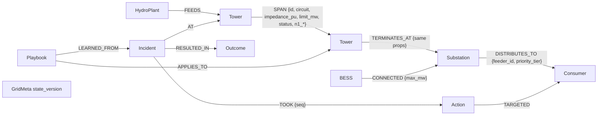

# GridPulse: an AI grid operator that FalkorDB keeps honest

**Graph Hacks (WeMakeDevs × FalkorDB) — Track 01: Agents That Act on Connected Data** (primary) **and Track 02: Agent Memory and Coordination.**

**[Watch the working demo video](https://drive.google.com/file/d/17HpaVV0qCSnjQsdwBz0pqCIWMxrXl-Lx/view?usp=sharing)**

When a 500 kV line fails, power instantly shifts onto the remaining paths and can cascade into a blackout. GridPulse puts an AI operator in front of that problem, but never in charge of it:
- **The agent investigates.** It uses FalkorDB queries and graph algorithms as its tools.
- **It remembers.** Past incidents and the plans that fixed them are stored as nodes in the same graph.
- **It proposes a plan.** That plan executes only after deterministic graph checks approve it against the live state. Every decision is backed by the exact Cypher, parameters, rows and a sha256 evidence fingerprint, in a hash-chained audit log.

Users can also **build their own electricity networks** (each in its own FalkorDB graph) and run test cases on them. That includes the public **IEEE 118-bus** system, where our power flows match pandapower to within 0.001 MW.

**Live demo: https://backend-production-a717.up.railway.app** (sign in with the demo operator button). The console is at `/`, and the full Lab at `/lab.html`.

## 3-minute judge tour

Open the live demo above (or start the app locally, see Quick start below), go to **/lab.html** and sign in with the demo button (top right).

1. **Live Ops.** Pick *AI operator* mode and click *Lightning TX_882*. Watch each step stream in: the memory recall, the blast-radius trace (with its Cypher), the mitigation search, the plan, the graph guard's verdict, then execution and verification.
2. **Run Wildfire (deterministic mode).** It's a different fault, but graph memory ranks the playbook learned at TX_882 as similar ("1 hop away, 100% shared downstream substations"). The guard re-approves it and it's reused in **1 decision step**. The **Memory** tab shows the learning curve, incidents, and playbooks with win/loss records; playbooks that keep failing retire themselves.
   - **Ask the Grid:** type a question in plain English, e.g. "Which loads can be shed?" or "most critical buses". Groq writes one Cypher query, GridPulse blocks writes and runs it read-only, and you see the answer, the query, the rows and the graph highlighted.
3. **Network Builder.** Two ways to get a grid in:
   - **Draw one.** Place buses, substations and generators by clicking. Connect lines by clicking two nodes. Attach loads and batteries to substations. Edit properties in the side panel. Undo and live validation are built in.
   - **Import a standard MATPOWER `.m` file,** or load a bundled IEEE 14/30/118 sample.

   Saved networks keep their drawn layout, each in its own graph `gridpulse_net_<id>`.
4. **Test Cases.** Run trips, demand surges and an N-1 scan, then click a row to highlight its overloads. Each case gets the smallest safe fix (battery first, then industrial shedding), or an honest *NOT_SAVEABLE*.
   - **🎓 Rehearse** "trains" the network: it works through every critical outage and demand surge and stores what worked as playbooks in that network's graph. Run the cases again and they're solved from memory.
5. **Analysis.** Try N-1 security, betweenness criticality, connected components (`algo.WCC`), zones (`algo.labelPropagation`), k-shortest reroutes (`algo.SPpaths`), and the blast-radius trace.
6. **Audit.** *Verify chain* recomputes every record's hash and link.
7. **Benchmark.** A measured FalkorDB vs SQLite multi-hop trace. Results are checked equal first, with honest numbers.

## Why the graph is central (Rule 3)

GridPulse cannot run without FalkorDB:

| Job | How FalkorDB does it |
| --- | --- |
| Grid state the agent reasons over | Property graph: plants, towers, substations, BESS and consumers; circuits are relationships keyed by `(id, circuit)` |
| Blast radius | Variable-length Cypher `[:FEEDS\|SPAN\|TERMINATES_AT*1..N]` with hop counts and paths |
| Power-flow inputs | One snapshot query returns every circuit, load and battery for the `dc-pf/1` solver |
| Mitigation discovery and the Tier-1 guard | Multi-hop patterns from substation to battery, and from breaker to feeder to consumer tier |
| Criticality, islands, zones, reroutes | `algo.betweenness`, `algo.WCC`, `algo.labelPropagation`, `algo.SPpaths`, `algo.BFS` |
| Agent memory | `Incident`, `Action`, `Outcome` and `Playbook` nodes linked to the grid elements they happened on; recall is a multi-hop query |
| N-1 results | Written back onto circuit relationships as `n1_*` tags |
| Per-user networks | One FalkorDB graph per network (multigraph isolation), plus an owner registry graph |

## Graph data model



- **Circuits:** each span ID (`TX_880`–`TX_888`) is a corridor segment with two parallel circuits (`UPPER_PRIMARY` and `LOWER_BACKUP`), stored as two relationships.
- **State version:** `GridMeta.state_version` increases with every simulator sync and every reset. Traces return it, and audit records store it.
- **More detail:** see [backend/graph/README.md](backend/graph/README.md) and [backend/graph/topology.py](backend/graph/topology.py).

## Key Cypher queries and graph algorithms

All of these live in `backend/graph/` and return their own evidence (query, parameters, rows, server time and hash).

```cypher
// Blast radius: shortest hop count and path to every downstream bus (queries.py)
MATCH (o) WHERE o.id = $start_id AND (o:HydroPlant OR o:Tower OR o:Substation)
MATCH p = (o)-[:FEEDS|SPAN|TERMINATES_AT*1..7]->(n)
WITH n, length(p) AS hops, [x IN nodes(p) | x.id] AS path ORDER BY hops
WITH n, min(hops) AS hops, collect(path)[0] AS path
RETURN n.id, labels(n)[0], hops, path, n.status ORDER BY hops

// Tier-1 guard: everyone a breaker (or its feeder) serves (queries.py)
OPTIONAL MATCH (:Substation)-[d:DISTRIBUTES_TO]->(:Consumer {breaker_id: $breaker_id})
WITH collect(DISTINCT d.feeder_id) AS feeders
MATCH (s:Substation)-[d2:DISTRIBUTES_TO]->(c:Consumer)
WHERE c.breaker_id = $breaker_id OR d2.feeder_id IN feeders
RETURN c.id, c.priority_tier, c.mw_demand, c.energized

// Mitigation assets: batteries and loads around a substation (queries.py)
MATCH (s:Substation {id: $substation_id})
OPTIONAL MATCH (b:BESS)-[k:CONNECTED]->(s)
WITH s, collect({id: b.id, soc_pct: b.soc_pct, max_discharge_mw: b.max_discharge_mw}) AS bess
OPTIONAL MATCH (s)-[d:DISTRIBUTES_TO]->(c:Consumer)
RETURN s.id, bess, collect({id: c.id, tier: c.priority_tier, mw: c.mw_demand, breaker: c.breaker_id}) AS consumers

// Agent memory: incidents within N hops of a fault (memory.py)
MATCH (o) WHERE o.id IN $ids
MATCH (o)-[:SPAN|TERMINATES_AT|FEEDS*0..2]-(n)
WITH collect(DISTINCT n.id) AS near
MATCH (i:Incident)-[:AT]->(p) WHERE p.id IN near
OPTIONAL MATCH (i)-[:RESULTED_IN]->(out:Outcome)
OPTIONAL MATCH (i)-[t:TOOK]->(a:Action)
RETURN i, out, collect(a) ORDER BY i.started_at DESC

// Graph algorithms used as agent and UI tools (algorithms.py)
CALL algo.betweenness({nodeLabels: ['HydroPlant','Tower','Substation'], relationshipTypes: ['FEEDS','SPAN','TERMINATES_AT']})
CALL algo.WCC({...same scope...})
CALL algo.labelPropagation({...same scope..., maxIterations: 30})
CALL algo.SPpaths({sourceNode: s, targetNode: t, relTypes: [...], weightProp: 'impedance_pu', pathCount: $k})
CALL algo.BFS(o, 6, 'LINE')   // benchmark
```

## The agent

- **Tools.** The agent (Groq, `openai/gpt-oss-120b`) uses graph tools through function calling:
  - `recall_memory`
  - `trace_cascade`
  - `find_mitigation_assets`
  - `check_breaker`
  - `verify_tier1_protection`
  - `reroute_paths`
  - `criticality_ranking`
  - `find_islands`
  - `evaluate_plan`
  - `submit_plan`
- **Approval.** A submitted plan is approved only by `evaluate_plan`, which runs the same guards the actuators use:
  - the Tier-1 and Tier-2 breaker guard
  - battery SOC and discharge limits
  - Tier-1 supply
  - a projection within limits

  Execution then re-checks against current state, and every actuation writes an audit "intent" record before it changes anything.
- **Graph as context layer.** Before the model's first turn, GridPulse runs the key FalkorDB queries and hands it a compact briefing, with each query's Cypher and evidence streamed as a step:
  - memory recall, with learned plans ranked for this fault
  - the blast-radius trace with the power-flow projection
  - the mitigation assets available

  Live on Groq's free tier, a lightning run takes 3 model turns, about 5k tokens and **about 4–7 s**. Rate-limit waits are bounded and shown as steps.
- **Learning loop (Track 02).** Every run is stored as an `Incident`. Playbooks are ranked for new faults by similarity × confidence × cost:
  - **Similarity:** exact trigger, fault kind, graph-hop distance, and shared downstream substations.
  - **Confidence:** a Laplace-smoothed win rate.
  - **Cost:** plans that shed less load rank higher.

  Reuse is linked as `(:Incident)-[:REUSED]->(:Playbook)` and credits the source playbook. Playbooks that keep failing retire, and a learning curve is exposed.
- **Fallback.** If the agent is unavailable or its plan is rejected, the deterministic pipeline takes over. That pipeline reuses a proven playbook when one exists, otherwise it runs a greedy battery-then-industrial plan.
- **MCP.** The same SCADA tools are exposed as an **MCP stdio server** (`backend/mcp/transport.py`), so any MCP client is bound by the same rules.

## Validation and honest benchmarks

- **Power flow vs pandapower.** The public IEEE 14, 30 and 118-bus cases (247 branches in total) are imported through our own MATPOWER parser, and `dc-pf/1` matches pandapower `rundcpp` within **0.001 MW** on every branch. This runs in CI against stored references (`backend/graph/data/`).
- **Graph vs SQL.** Every engine's results are checked equal before timing.
  - Local 6-hop traces take **well under 1 ms** for FalkorDB Cypher (0.03–0.04 ms) and for an indexed SQLite recursive CTE (0.04–0.06 ms), on grids from 1k to 100k buses.
  - The GraphBLAS `algo.BFS` wins on deep traversals of small graphs, but its cost grows with graph size.
  - **The often-quoted "SQL takes 450 ms" is not reproduced here.** The graph's value is that one model drives traversal, algorithms, power flow and memory.
- **N-1 at scale.** A vectorised LODF N-1 scan covers all 2,103 outages of a 992-bus mesh in about 50 ms, matching exact re-solves to 1e-12 MW.
- **Safety properties.** Randomised tests (16 seeds of faults, demand and SOC) check that no Tier-1 or Tier-2 load is ever shed, battery limits hold, every actuation has a prior intent record, and the audit chain verifies.

## Quick start (submission requirement)

```sh
cp .env.example .env            # add GROQ_API_KEY=... to enable the AI agent (free tier works)
docker compose up --build       # FalkorDB + backend + UI on http://localhost:8000
```

- **Console:** http://localhost:8000/ — live topology, diagnostics, agent, audit, Ask the Grid, Network Lab, and Grid Memory in one themed workspace. The topology supports animated current flow and full screen viewing.
- **Advanced Lab:** http://localhost:8000/lab.html — visual network editor, test cases, analysis, benchmarking, and the deeper API tools. Open it from Network Lab to carry the active session across.
- **Landing page:** http://localhost:8000
- **Operator dashboard:** http://localhost:8000/login.html
- **API docs:** http://localhost:8000/docs

Without `GROQ_API_KEY`, everything works except the LLM agent, and AI-operator mode falls back to the deterministic pipeline.

## Deploying (Railway)

`railway.json` and the `Dockerfile` are deployment-ready: the server listens on the host's `PORT` and runs one worker, because sessions and simulator state live in memory.

1. **Backend service:** create it from the GitHub repo.
2. **FalkorDB service:** create it from the image `falkordb/falkordb`, with a volume at `/data`.
3. **Backend variables:**
   - `FALKORDB_HOST` = the FalkorDB service's private domain
   - `FALKORDB_PORT=6379`
   - `GROQ_API_KEY`
   - `GRIDPULSE_AUDIT_DB=/app/data/audit_log.db`, plus a volume at `/app/data`
4. **Public URL:** generate a public domain for the backend.

Groq-backed features share a per-hour and per-user budget (`GRIDPULSE_AI_PER_HOUR`, `GRIDPULSE_AI_PER_USER_10MIN`), so a public demo can't exhaust the key. Set `GRIDPULSE_AI_ENABLED=0` to switch them off. AI-operator mode then falls back to the deterministic pipeline.

### Showcase data

Four fictional demo grids ship as templates, each showing a different behaviour (`backend/graph/showcase.py`):

| Template | What it shows |
| --- | --- |
| Harbor City metro | Meshed 9-bus city with gas and offshore wind; most single-line losses are saved by battery support plus Tier-3 shedding, a few are not. |
| Cascade Valley hydro | Double-circuit hydro valley; losing the radial Summit spur islands a clinic, which no battery or shedding can fix. |
| Sunridge solar microgrid | Solar ring microgrid; losing a ring segment next to the grid tie is saved by shedding the bus depot. |
| Riverside industrial park | Industrial corridor where shedding a 280 MW smelter relieves the overload. |

To fill a running site with demo data, run the seeder against it:

```bash
python scripts/seed_showcase.py --base https://<your-app>
```

The seeder saves the four grids and an imported IEEE 30-bus case for every one-click demo login (operator, engineer and auditor) and for the Lab's default user. It then rehearses each grid so its memory holds incidents and playbooks, runs every live scenario twice, records one refused hospital-breaker trip, and leaves the grid nominal. It makes no AI calls, and re-running it replaces the earlier copies.

## AI assistance disclosure (Rule 11)

This project was built with AI coding assistants: **Claude Code** (graph engine, MCP layer, Lab UI), **Codex** (frontend) and **Antigravity** (simulator, auth, audit, infrastructure). Each team member directed the work on their own module. Assistant-written code is covered by the test suite and CI described above.

## Start the complete app (details)

Requires a running Docker Desktop. From the repository root:

```sh
docker compose up --build
```

Open **http://localhost:8000**, choose **Launch Console**, then **Chief Grid Operator**. Run lightning, inspect the Cypher trace and audit evidence, reset, and repeat for wildfire and heatwave. Engineer and auditor are read-only. API documentation: http://localhost:8000/docs.

Both the frontend and API use port 8000. The verified FalkorDB image is pinned by digest. Compose publishes FalkorDB on `127.0.0.1:6379`. If something else already uses 6379, set `FALKORDB_HOST_PORT` in an untracked `.env`, or pass it inline:

```sh
FALKORDB_HOST_PORT=6380 docker compose up --build
```

If this sandbox denies Buildx's default cache directory, use the equivalent verified command:

```sh
mkdir -p work/buildx
BUILDX_CONFIG="$PWD/work/buildx" docker compose up --build
```

The backend always connects to the Compose service `falkordb:6379`; the host port only affects host-side development/tests. Database files persist in the Compose volume; audits persist in `./data/audit_log.db`. Startup restores nominal graph/simulator state and preserves audit history. Run **one backend worker**. Login tokens live in memory: after a backend restart, sign out and log in again. The dashboard reports an expired session instead of retrying it forever.

## Repository-local Python environment

Verified with Python 3.11. Development dependencies belong to this checkout:

```sh
python3 -m venv .venv
source .venv/bin/activate
python -m pip install -r backend/requirements-dev.txt
# When using the Compose database on host port 6380:
FALKORDB_PORT=6380 python -m uvicorn backend.main:app --host 127.0.0.1 --port 8000
```

Stop the Compose backend first (`docker compose stop backend`) before starting a host backend on the same port. Outside Compose, `.env` is not loaded automatically: export configuration or prefix commands as above. See `.env.example`. Never commit tokens or `.env`.

## Model and runtime behavior

- `backend/graph/topology.py` is the nominal source of IDs and values. `TX_882` connects T3→T4; `TX_884` connects T5→T6; `TX_888` connects T9→SUB_METRO. Consumers connect through `DISTRIBUTES_TO`.
- One simulator owns state. Its updates reach FalkorDB before graph decisions. The deterministic interceptor calls the shared Python guard functions; the external MCP bridge forwards to HTTP adapters in that same running backend.
- The documented `dc-pf/1` linear power-flow projection models parallel circuits, meshed corridors and PTDF-based load relief (see `backend/graph/README.md`). Nominal demand is 840 MW. Heatwave multiplies every consumer by exactly 1.2: **1008 MW / 120% before mitigation**. Industrial demand is 62 MW nominal / 74.4 MW during heatwave. After shedding and 45 MW BESS support, energized demand is 778 MW for lightning/wildfire or 933.6 MW for heatwave; net substation load is 733 MW or 888.6 MW respectively.
- Cypher evidence contains actual query text, parameters, returned rows, hashes and measured timings. Dashboard latency is the sum of server times for the pre-action trace queries, not physical actuation latency or a fixed 1.4 ms benchmark.
- Every actuation requires current graph guards and durable audit intent before simulator mutation. Only isolated Tier-3 breakers are eligible; a supplied audit hash cannot authorize a hospital trip. BESS requires SOC above 40%, a finite positive amount within discharge/connection limits, and `LOWER_BACKUP`. Dispatch is an **absolute MW setpoint**, so repeating 45 MW does not add another 45 MW.
- Successful actions refresh projected circuit flows. A failure after actuation records the applied result, intent ID and uncertain confirmation, marks the runtime failed, and requires reset. Audit failure before intent prevents actuation.
- A duplicate trigger while a run is active returns the current run. A different concurrent scenario, or another trigger after completion, returns 409 until reset. Reset cancels pending work and preserves audits.
- Mutating control routes require an operator login. All four SCADA tool adapters require a login; read-only roles can query tools but cannot actuate. WebSocket telemetry requires a current login token. No static bypass token is seeded.
- A disconnected WebSocket retries and refreshes authoritative topology/state. Failed initial topology loads also retry. The topology shows the actual faulted span, backup reroute, BESS connection and shed consumer feeder. On narrow screens the diagram scrolls within its panel.
- With an unavailable database, the site/login remain available, `/health` reports `DEGRADED`, and live graph actions fail explicitly. **Offline simulation** is a labelled browser-only model: no database timings and no queued backend actions. Sign out and log in again to return to live mode.

## Grid analysis, AI advisor and audit integrity

- **N-1 security**: `POST /api/graph/contingency` trips each circuit in turn, re-solves, and tags circuits in FalkorDB. The demo grid is not N-1 secure: every primary outage overloads its backup.
- **Graph algorithms**: `GET /api/graph/criticality` (betweenness centrality) and `GET /api/graph/reroute` (k lowest-impedance energised paths via `algo.SPpaths`).
- **What-if plans**: `POST /api/graph/evaluate-plan` checks `{trip_breakers, bess_dispatch}` against the actuation guards without actuating.
- **Graph vs SQL benchmark**: `POST /api/graph/benchmark` and `python -m backend.graph.benchmark --sizes 1000 10000 100000 --hops 6 10`. The measured results, including where SQL is as fast or faster, are in `backend/graph/README.md`.
- **LLM advisor (Groq)**: `POST /api/mcp/agent/advise` (any logged-in role; `{"execute": true}` requires the operator role).
  - A Groq-hosted model (`openai/gpt-oss-120b` by default, override with `GRIDPULSE_AGENT_MODEL`) investigates with read-only graph tools through function calling, and must submit a plan.
  - `evaluate_plan` then validates the plan deterministically, and the proposal is audited as `AGENT_PROPOSAL`.
  - Execution re-checks against current state and goes through the guarded SCADA tools; the model's output alone never authorizes anything.
  - Malformed tool calls are retried or returned to the model as tool errors.
  - Requires `GROQ_API_KEY`; without it the endpoint returns 503 `AGENT_UNAVAILABLE`.
- **Audit chain**: each audit record stores `seq`, `prev_hash`, `record_hash` and the graph `state_version` the action was based on. `GET /api/audit/verify` recomputes the chain and reports the first broken link. Older databases are migrated in place, and their pre-chain rows are reported as `legacy_unchained`.
- **Event loop**: graph and SQLite work in scenario, reset and tool paths runs in worker threads while the simulator lock is held, so WebSocket telemetry keeps flowing during a run.
- **Ask the grid**: `POST /api/mcp/ask {question, network_id?}` turns plain English into one guarded, read-only Cypher query (keyword guard plus `GRAPH.RO_QUERY`). It retries once on error and returns the answer, Cypher, rows, highlighted ids and an evidence hash.
- **Graph memory**: `GET /api/graph/memory/incidents`, `/memory/playbooks`, `/memory/recall?origin_id=`, `/memory/suggest?origin_id=` and `/memory/learning` (the learning curve) expose episodic and procedural memory. Per network: `POST /api/networks/{id}/rehearse` and `GET /api/networks/{id}/memory`. Every finished run is recorded; memory survives grid resets.
- **AI-operator mode**: `POST /api/sim/trigger-scenario/{1|2|3}?mode=agent` streams agent steps in telemetry (`agent_steps`), executes only guard-approved plans, and falls back to the deterministic pipeline.
- **User-built networks**: `/api/networks` covers create, list, get, replace, delete, validate, templates, `convert` (MATPOWER `.m` or spec JSON to a preview spec), `samples/{ieee14,ieee30,ieee118}` and simulate, plus topology, trace, contingency, criticality, reroute, islands and zones per network. Networks are scoped to the logged-in operator.
- **Tests and CI**: `.github/workflows/ci.yml` runs the full suite against a FalkorDB service container on every push and pull request. Coverage includes:
  - randomised safety properties over 16 seeded fault/demand/SOC combinations (`backend/mcp/test_random_safety.py`)
  - audit tamper detection
  - the agent loop, driven by a scripted model client so no API calls are made.

## MCP transport

The supplied project specification explicitly describes Model Context Protocol SCADA tools. No separate hackathon judging rubric was supplied, so an organizer requirement cannot be established from the repository. HTTP routes named `/api/mcp/tools/*` alone are not an MCP transport.

`backend/mcp/transport.py` now supplies genuine **MCP JSON-RPC over stdio**, using the official Python SDK pinned to 1.30.0. An MCP client can initialize, discover schemas and call all four documented tools. The bridge imports no simulator or graph state; it sends requests to the running app, preserving the same roles, graph guards, locking and audits. The dashboard's deterministic interceptor remains an in-process caller of those shared functions; it does not use an LLM or send its internal calls over MCP.

Configure an MCP client's stdio server command as the absolute path to this repository's `.venv/bin/python`, with arguments `-m backend.mcp.transport`, working directory set to this repository, and these environment variables:

```text
GRIDPULSE_API_URL=http://127.0.0.1:8000
GRIDPULSE_MCP_TOKEN=<access_token returned by POST /api/auth/login>
```

A token can be obtained with `POST /api/auth/login` and JSON `{"demo":true,"role":"operator"}`. Keep it out of committed client config. Relogin and replace the token after backend restart. There is **no HTTP Streamable MCP/SSE endpoint** or OAuth flow. The LLM agent (Groq) runs in-process and calls the same guarded functions; see "The agent" above.

## Verified results — 15 October 2026

```sh
# FALKORDB_PORT is the host port of the Compose database (6379 unless overridden):
FALKORDB_PORT=6380 GRIDPULSE_REQUIRE_FALKORDB=1 .venv/bin/python -m pytest -q
# Require real database tests; do not allow connection-based skips:
FALKORDB_PORT=6380 GRIDPULSE_REQUIRE_FALKORDB=1 .venv/bin/python -m pytest backend/graph/tests -q
```

**156 passed, zero skipped** overall (re-verified in a fresh venv built only from the requirements files, and from a fresh clone). The required graph suite: **86 passed, zero skipped**. Both report one upstream Starlette/httpx TestClient deprecation warning. The graph suite includes pure model tests as well as real Cypher tests. `backend/mcp/test_live_runtime.py` adds seven real-database app/runtime tests with isolated graph names and audit files; it does not substitute graph answers. Other app/SCADA fixture tests remain explicitly labelled as fixtures.

Live database coverage includes repeated seeding, graph traversal, all three complete scenario pipelines, evidence hashes, Tier-1 protection, operator/read-only HTTP and WebSocket behavior, duplicate/conflicting triggers, reset cancellation, insufficient battery capacity, rejected hospital trips, repeatable battery setpoints and projected state synchronization. Partial confirmation and audit-write failures have additional fault-injection regression tests.

Two separately executed acceptance checks are committed:

```sh
# Resets this demo, restarts its backend, and stops/starts its database.
# Requires Docker access; preserves audit history and leaves the grid nominal.
.venv/bin/python tests/verify_running_stack.py

# Requires Node + Playwright Chromium; can be run against the current app.
npm install --prefix work/browser playwright@1.64.1
PLAYWRIGHT_BROWSERS_PATH="$PWD/work/browsers" work/browser/node_modules/.bin/playwright install chromium
NODE_PATH="$PWD/work/browser/node_modules" PLAYWRIGHT_BROWSERS_PATH="$PWD/work/browsers" node tests/browser.cjs
```

The running-stack check passed actual MCP stdio initialize/list/query/dispatch and permission rejections; audit persistence across a real backend process restart; an actual stopped FalkorDB returning 503 without fault injection or actuation; continued landing-page availability; and dependency recovery/reset.

Browser acceptance passed landing→demo login→dashboard→lightning→real graph evidence→mitigation→audit→reset, wildfire, exact 120%/1008 MW heatwave telemetry, both themes, 1440px desktop and 390px narrow layouts, canonical span mapping, live fault/reroute styling, reset during a run, WebSocket reconnect, offline action isolation, and both read-only roles. The check also covers retry after a failed topology load and an expired session. No JavaScript page errors occurred. Verification used headless Chromium in `mcr.microsoft.com/playwright:v1.64.1-noble` because the local macOS browser process was blocked by the sandbox; Safari and Firefox were not tested.

Python compilation, JavaScript syntax and `git diff --check` passed. The landing HTML, its animation script, and shared specification are unchanged from integration commit `093c2ee`.

## Remaining limitations

This is a deterministic educational DC power-flow model, not validated AC power flow, thermal protection timing, physical SCADA, production authentication or NERC certification. The preserved landing narrative includes illustrative benchmark/timing claims; these are not results from this verification. Fonts and the landing Tailwind enhancement use external CDNs; existing fallback styles remain in place. SQLite audits are hash-chained and verifiable (`GET /api/audit/verify`), which makes edits and deletions detectable but is not tamper-proof against someone who can rewrite the whole chain; and SQLite/graph/simulator updates are not a distributed transaction. Process restart restores nominal state rather than resuming a run; unresolved crash-time intents require inspection. Demo tokens have no production expiry/revocation service. MCP is a stdio bridge and requires the app plus a valid session. No environment blocker remains for the verified Compose/Chromium workflow.
